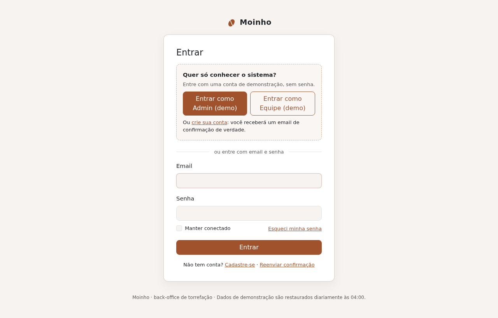
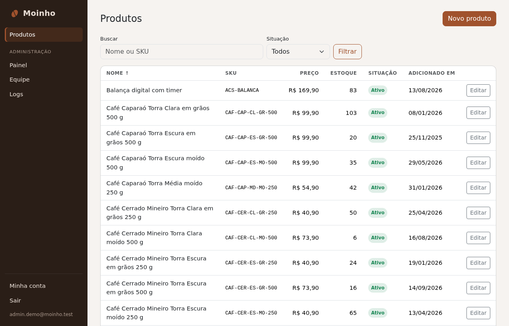
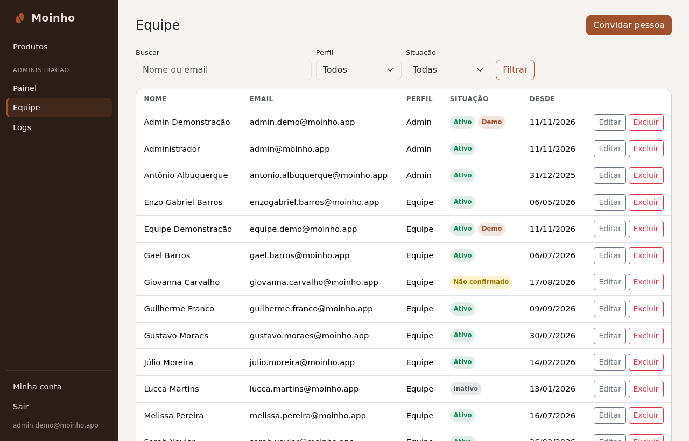
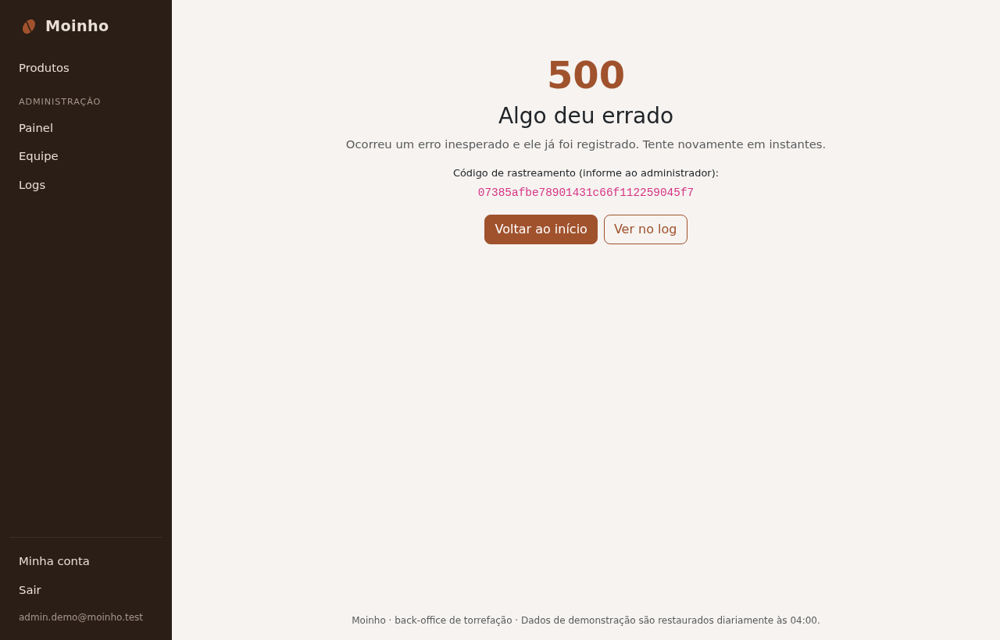
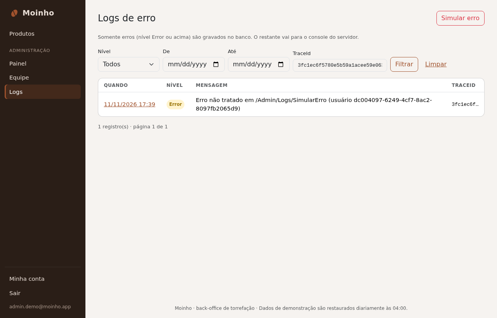
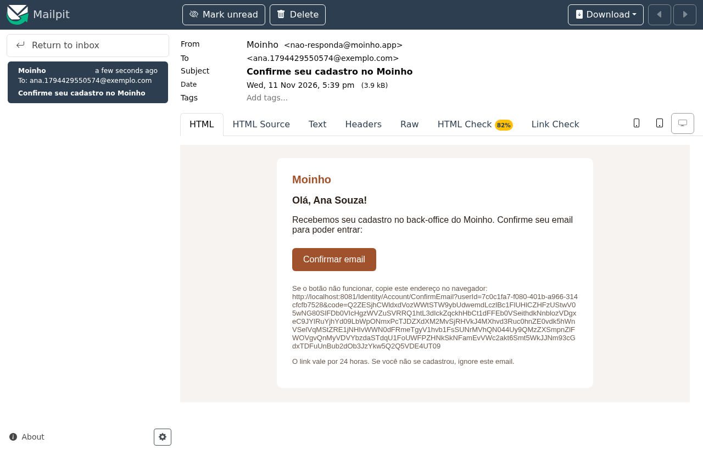
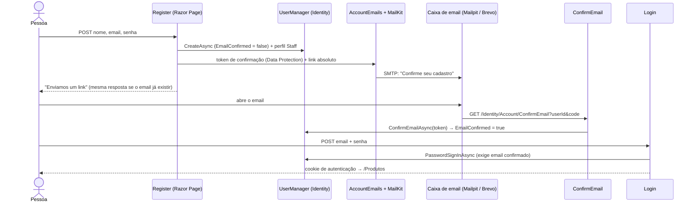

# Moinho: back-office de uma torrefação de café

Sistema interno onde a equipe de uma torrefação (grãos, cafés moídos, cápsulas e acessórios) gerencia o catálogo de produtos. O foco é **segurança por perfis com ASP.NET Core Identity**: área administrativa só para Admin, cadastro com confirmação por email, troca e recuperação de senha, envio de email de verdade, dados de exemplo e erros gravados no banco.

Feito em **C# / ASP.NET Core MVC (.NET 10)**, **EF Core + SQL Server**, **Bootstrap 5.3 + jQuery**, com testes de integração em xUnit e Testcontainers.

**Demo online:** ainda não publicado (veja [docs/DEPLOY.md](docs/DEPLOY.md)).
Na tela de login há dois botões, **"Entrar como Admin (demo)"** e **"Entrar como Equipe (demo)"**, que entram em contas de demonstração protegidas sem precisar de senha. Também dá para criar sua própria conta: o email de confirmação chega de verdade.

| Login com acesso de demonstração | Produtos |
|---|---|
|  |  |
| **Equipe (área Admin)** | **Erro com código de rastreamento** |
|  |  |
| **Logs de erro (área Admin)** | **Email de confirmação no Mailpit** |
|  |  |

Mais telas: [painel](docs/screenshots/admin-painel.png), [validação de preço pt-BR](docs/screenshots/produto-validacao.png), [modo escuro](docs/screenshots/produtos-escuro.png), [celular](docs/screenshots/produtos-celular.png).

---

## Requisitos do desafio → implementação

| Requisito (C# Academy) | Como foi atendido |
|---|---|
| Back-office onde usuários gerenciam produtos | `ProductsController` (`/Produtos`), política `RequireStaff` |
| Qualquer front-end ASP.NET | MVC para o app e a área Admin + **páginas Razor do Identity geradas pelo scaffolder** para as contas ([ADR 0001](docs/adr/0001-mvc-plus-scaffolded-identity-pages.md)) |
| Usar ASP.NET Core Identity | `ApplicationUser : IdentityUser`, perfis `Admin` e `Staff`, cookies do Identity |
| Adicionar, excluir, editar e ver produtos | CRUD completo; exclusão com página de confirmação (GET) + POST |
| Produto com `IsActive`, `DateAdded`, `Price` | + `Name`, `Sku` (único), `Description`, `StockQuantity`, `UpdatedAt`; `DateAdded` definido pelo servidor |
| Área Admin só para o perfil Admin | Área `Admin` com `AdminControllerBase` (`[Authorize(Policy = "RequireAdmin")]`) e um teste que verifica isso por reflexão |
| Admin adiciona, edita, exclui e vê a equipe | `/Admin/Equipe` via `StaffService` (convite por email, regras de auto-proteção, último admin e contas protegidas) |
| Cadastro da equipe com confirmação por email | Página Register → email com link → ConfirmEmail; login recusado antes de confirmar |
| **"Reset their password"** | Interpretado como **trocar a senha logado**: Minha conta → Senha (`Manage/ChangePassword`) |
| **"Recover their forgotten password"** | **Esqueci minha senha** → email com link → ResetPassword. O enunciado é ambíguo, então os dois fluxos existem |
| Serviço de email real | `SmtpEmailSender` (MailKit, SMTP): Mailpit no dev, Brevo ou Resend em produção |
| Dados de teste (seed) | `Seeder` determinístico: 60 produtos, 10 pessoas da equipe em estados variados, admin real e 2 contas demo |
| Banco e tabelas criados com `EnsureCreated` | `DbInitializer` na inicialização ([ADR 0002](docs/adr/0002-ensurecreated-instead-of-migrations.md)) |
| Logging com erros no banco | Serilog: console + tabela `ErrorLogs` (Error ou acima); página Admin → Logs ([ADR 0005](docs/adr/0005-errors-to-database-with-serilog.md)) |
| README com instruções e escolhas | Este arquivo, os ADRs e o [guia de estudo](docs/STUDY_GUIDE.md) |
| Reflexão em palavras próprias | Seção [Reflexão](#reflexão) (escrita pelo autor) |

---

## Como rodar

### Com Docker (um comando)

Pré-requisito: Docker Desktop (no Windows, com WSL 2) ou Docker Engine com Compose v2.

```bash
git clone <este-repositório> moinho && cd moinho
docker compose up --build
```

| O quê | Onde |
|---|---|
| Aplicação | http://localhost:8080 |
| Emails enviados (Mailpit) | http://localhost:8025 |
| SQL Server | `localhost,1433`, usuário `sa`, senha `Moinho_Dev_2026!` |

Na primeira vez o SQL Server leva 1–2 minutos para subir; o app espera por ele.
Se as portas 8080, 1433, 8025 ou 1025 já estiverem em uso, copie `.env.example` para `.env` e troque `WEB_PORT`, `SQL_PORT`, etc.
Em Mac com Apple Silicon, a imagem do SQL Server é amd64 e roda emulada (mais lenta, mas funciona).

### Pela IDE (Visual Studio, Rider ou VS Code)

Suba só o banco e o Mailpit no Docker e rode o app pela IDE:

```bash
docker compose up -d sqlserver mailpit
dotnet run --project src/Moinho.Web     # http://localhost:5080
```

`appsettings.Development.json` já aponta para `localhost,1433` e para o Mailpit (`localhost:1025`).

### Testes

```bash
dotnet test
```

Os testes sobem um SQL Server descartável (Testcontainers), então o Docker precisa estar rodando. Cada classe de teste ganha um banco novo, criado pelo mesmo `EnsureCreated` da aplicação.

### Zerar o banco

```bash
docker compose down -v      # apaga o volume do SQL Server; o próximo "up" recria e popula
```

### Contas

| Conta | Como entrar | Perfil |
|---|---|---|
| Admin (demo) | botão "Entrar como Admin (demo)" | Admin, protegida |
| Equipe (demo) | botão "Entrar como Equipe (demo)" | Staff, protegida |
| Admin real | `admin@moinho.test` / `Admin_Dev_2026!` (dev; mude em `.env`) | Admin, protegida (perfil, email e situação não mudam pela área Admin) |
| Sua conta | "Cadastre-se" → confirme pelo email no Mailpit | Staff |

---

## Como funciona

### Perfis e políticas

- **Autenticação** (quem é você) usa o cookie do Identity. **Autorização** (o que você pode fazer) usa políticas:
  - `FallbackPolicy`: qualquer endpoint exige login, a menos que tenha `[AllowAnonymous]` (login, cadastro, confirmação, recuperação de senha e páginas de erro).
  - `RequireStaff`: perfil Admin **ou** Staff (produtos).
  - `RequireAdmin`: perfil Admin (área Admin).
- Toda a área Admin herda de `AdminControllerBase`, então nenhum controller "esquece" o atributo. Um teste varre os controllers por reflexão e falha se algum não tiver a política.
- O link "Administração" do menu só aparece para Admin, mas isso é conveniência: a proteção é a política no servidor (Staff recebe **403** ao digitar `/Admin`).
- **Security stamp verificado a cada requisição** ([ADR 0003](docs/adr/0003-security-stamp-validation-interval-zero.md)): quem é rebaixado, desativado ou excluído perde o acesso na próxima requisição, e não 30 minutos depois.

### Área Admin

- **Painel:** produtos ativos e inativos, equipe por situação, erros nas últimas 24 h.
- **Equipe:** busca, filtros por perfil e situação, convite, edição e exclusão. Regras (em `StaffService`):
  - ninguém remove o próprio acesso (rebaixar, desativar ou excluir a si mesmo);
  - o **último Admin ativo** não pode ser rebaixado, desativado ou excluído (checado dentro de uma transação serializável);
  - contas protegidas (as demos e o admin real) não mudam de perfil, email ou situação e não podem ser excluídas; as demos também não trocam senha nem nome;
  - ninguém troca o próprio email pela tela da Equipe (use Minha conta → Email, que só troca depois da confirmação);
  - quem é adicionado pelo admin recebe um **convite** para definir a própria senha ([ADR 0004](docs/adr/0004-staff-invitations-instead-of-admin-set-passwords.md));
  - "Inativo" é um bloqueio sem prazo (`LockoutEnd = DateTimeOffset.MaxValue`).
- **Logs:** lista paginada com filtro por nível, período e TraceId; detalhe com mensagem, exceção e propriedades. O botão **Simular erro** (só na demo) lança uma exceção de propósito.

### Fluxos de conta



- **Trocar a senha** (logado): Minha conta → Senha. Muda o security stamp, então as outras sessões caem.
- **Esqueci minha senha:** email com link (vale 2 h) → nova senha. A resposta é igual exista o email ou não.
- **Trocar email:** o email só muda depois de clicar no link enviado ao **novo** endereço.
- **Reenviar confirmação:** para quem perdeu o primeiro email.
- Cadastro, "esqueci minha senha", "reenviar confirmação", troca de email e convites têm **limite por IP** (5 POSTs a cada 15 min), porque enviam email para qualquer endereço digitado. A edição de pessoas na área Admin tem um limite próprio, mais folgado (30 a cada 15 min).

### Serviço de email

- `SmtpEmailSender` implementa o `IEmailSender` usado pelas páginas do Identity, com MailKit. Configuração em `Email:Host/Port/User/Password/From/UseStartTls`.
- `EmailTemplates` gera HTML simples em pt-BR e o remetente gera a versão texto. `AccountEmails` cria os tokens e links e trata falhas: registra em nível Error (vai para o banco) **sem o link nem o token** e mostra uma mensagem amigável.
- Os links são absolutos e usam o esquema e o host da requisição. Atrás do Caddy, o middleware de **forwarded headers** faz o link apontar para o domínio público, e não para `http://web:8080` (há um teste para isso).

### Erros no banco

1. Uma exceção não tratada chega ao `UseExceptionHandler("/Erro")`.
2. O `ErrorController` registra em nível Error com o caminho e o id do usuário (nunca senhas, tokens ou o formulário).
3. O Serilog envia ao console e, por ser Error de código nosso, à tabela `ErrorLogs` (em lote; o sink grava a cada poucos segundos).
4. A página mostra uma mensagem amigável e o **TraceId**, o mesmo valor gravado na linha.
5. Em Admin → Logs, o filtro por TraceId encontra exatamente aquela linha.

403, 404 e 429 mostram páginas amigáveis e **não** são registrados como erro.

### EnsureCreated e seus limites

O banco e todas as tabelas (Identity, Products, ErrorLogs) são criados a partir do modelo do EF na primeira execução. Não há migrations: **uma mudança de esquema exige apagar o banco** (`docker compose down -v`). Como todos os dados são de exemplo, isso é aceitável aqui. Num sistema real eu usaria migrations aplicadas por um *migration bundle* ou script SQL no deploy ([ADR 0002](docs/adr/0002-ensurecreated-instead-of-migrations.md)).

### O preço em pt-BR

Com a cultura pt-BR, "12.50" seria lido como **1250** (o ponto separa milhares). O campo de preço é texto (`inputmode="decimal"`) validado por uma expressão regular de formato brasileiro, tanto no servidor quanto no navegador (jquery-validation, pelo mesmo atributo). "12,50" e "1.234,56" são aceitos; "12.50" recebe uma mensagem clara em vez de ser salvo errado.

---

## Escolhas de arquitetura

- **Dois projetos só:** `src/Moinho.Web` e `tests/Moinho.Tests`. Sem camadas extras: controllers e páginas usam serviços pequenos (`ProductService`, `StaffService`, `AccountEmails`) que falam direto com o `AppDbContext` e o `UserManager`. Sem repositórios, MediatR ou AutoMapper.
- **MVC + Razor Pages do Identity:** [ADR 0001](docs/adr/0001-mvc-plus-scaffolded-identity-pages.md)
- **EnsureCreated em vez de migrations:** [ADR 0002](docs/adr/0002-ensurecreated-instead-of-migrations.md)
- **Security stamp a cada requisição:** [ADR 0003](docs/adr/0003-security-stamp-validation-interval-zero.md)
- **Convite em vez de senha escolhida pelo admin:** [ADR 0004](docs/adr/0004-staff-invitations-instead-of-admin-set-passwords.md)
- **Erros no banco com Serilog e tabela mapeada no EF:** [ADR 0005](docs/adr/0005-errors-to-database-with-serilog.md)
- **Contas demo protegidas e reset diário:** [ADR 0006](docs/adr/0006-demo-accounts-and-nightly-reset.md)

### Rotas do Identity UI desativadas

A biblioteca Identity UI traz páginas que este app não usa. Uma convenção de rotas (`Areas/Identity/IdentityPages.cs`) remove todas que não estão na lista de usadas, e elas respondem **404** para quem está logado. Quem não está logado é mandado para o login, como em qualquer endereço desconhecido, por causa da `FallbackPolicy`:

`Account/AccessDenied`, `Account/ExternalLogin`, `Account/LoginWith2fa`, `Account/LoginWithRecoveryCode`, `Manage/SetPassword`, `Manage/ExternalLogins`, `Manage/PersonalData`, `Manage/DownloadPersonalData`, `Manage/DeletePersonalData`, `Manage/TwoFactorAuthentication`, `Manage/EnableAuthenticator`, `Manage/ResetAuthenticator`, `Manage/GenerateRecoveryCodes`, `Manage/ShowRecoveryCodes`, `Manage/Disable2fa` e `/Identity/Error`.

---

## Limites conhecidos

- **Última gravação vence:** se duas pessoas editam o mesmo produto ao mesmo tempo, a última sobrescreve a outra. O próximo passo seria concorrência otimista (`rowversion` + `DbUpdateConcurrencyException`).
- **EnsureCreated:** mudar o modelo exige recriar o banco (veja acima).
- **Reset diário da demo (04:00, horário de Brasília):** apaga contas criadas, produtos novos e logs, e desconecta todo mundo.
- **Cota do provedor de email:** Brevo grátis = 300 emails/dia; Resend grátis = 100/dia. O limite por IP protege a cota, mas muitos visitantes diferentes ainda podem esgotá-la.
- O convite expira em 2 h (é um token de redefinição de senha); depois disso a pessoa usa "Esqueci minha senha".
- Ao errar a senha numa conta bloqueada ou inativa, a tela de bloqueio aparece antes da checagem de senha (comportamento padrão do Identity), o que revela que a conta existe e está bloqueada.

---

## Requisitos da vaga → onde estão no código

| Requisito | Onde ver |
|---|---|
| C# | todo o `src/` (C# 14, nullable habilitado, namespaces por arquivo) |
| ASP.NET Core MVC | `Controllers/ProductsController.cs`, `Areas/Admin/Controllers/*`, `Views/`, filtros globais em `Program.cs` |
| Web API | rotas por atributo, códigos HTTP corretos (403/404/429/500); os testes de integração exercitam o app por HTTP como um cliente de API faria |
| .NET | .NET 10 LTS, hospedagem mínima, `BackgroundService`, `TimeProvider`, rate limiter nativo |
| Git | histórico com um commit por etapa (`stage N: ...`), CI no GitHub Actions |
| HTML, CSS, JavaScript, jQuery | Razor + Bootstrap 5.3, `wwwroot/css/site.css`, validação com jQuery Validation (unobtrusive) |
| SQL relacional | SQL Server, índice único em `Sku`, transação serializável na regra do último admin, `ExecuteDeleteAsync` no reset |
| EF Core (diferencial) | `Data/AppDbContext.cs`, consultas com filtro, ordenação e paginação em `Services/*Service.cs` |
| Bootstrap (diferencial) | layout, tabelas, formulários e modo escuro automático |
| Postman (diferencial) | os fluxos podem ser chamados com qualquer cliente HTTP; os testes em `tests/` fazem exatamente isso (GET do formulário → token antiforgery → POST) |

---

## Estrutura

```
src/Moinho.Web
  Areas/Admin        área Admin (MVC): Painel, Equipe, Logs
  Areas/Identity     páginas de conta geradas pelo scaffolder (pt-BR)
  Controllers/       Produtos, Erro, Demo
  Data/              DbContext, EnsureCreated + seed, reset da demo, sink de erros
  Models/            entidades e opções
  Services/          regras e infraestrutura (email, equipe, produtos)
  ViewModels/        o que as telas recebem e enviam
  Views/             layout e telas MVC
tests/Moinho.Tests   testes de integração (WebApplicationFactory + Testcontainers)
docs/                ADRs, guia de estudo, deploy, progresso, screenshots
```

`dotnet-tools.json` fixa a versão do scaffolder oficial do Identity (`dotnet tool restore`, depois `dotnet aspnet-codegenerator identity ...`), caso você queira gerar mais páginas.

Deploy em VPS (Caddy + HTTPS, SQL Server Express ou compartilhado) e Azure: [docs/DEPLOY.md](docs/DEPLOY.md).
Para estudar o código em ordem: [docs/STUDY_GUIDE.md](docs/STUDY_GUIDE.md).

---

